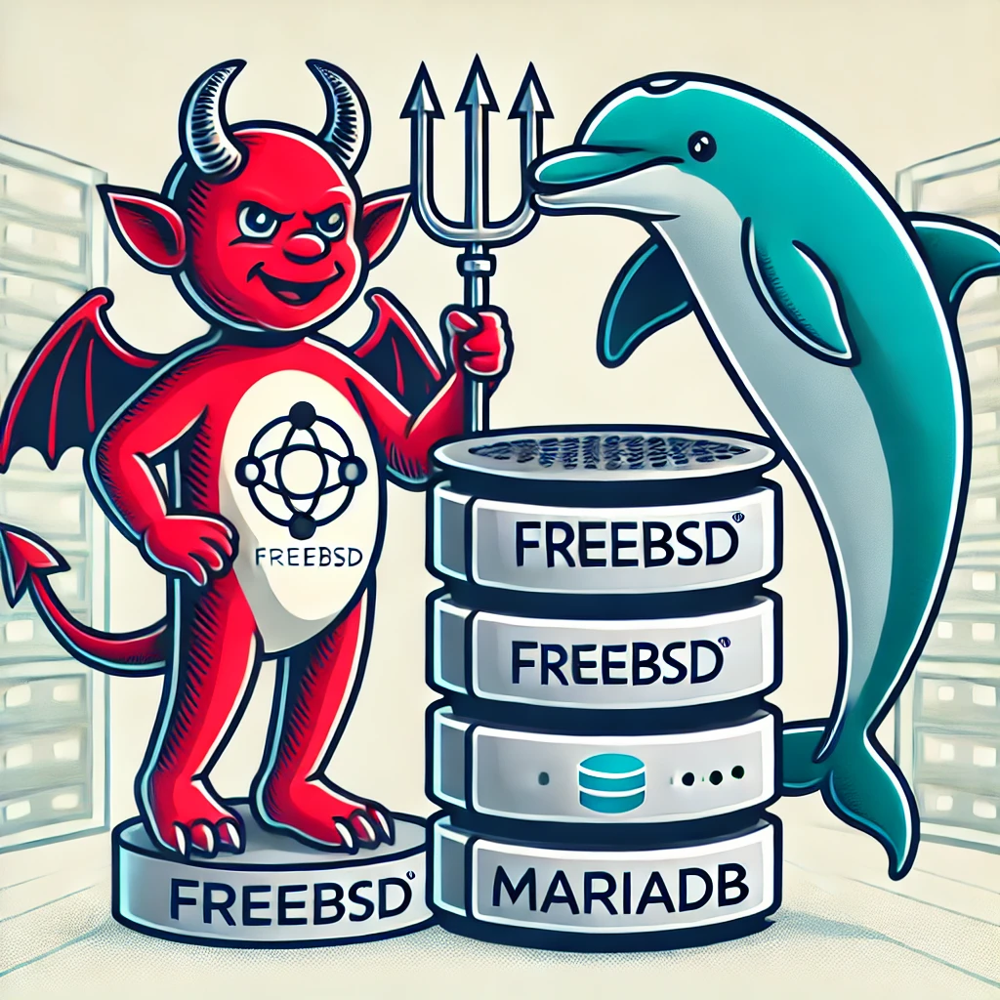

# Install MariaDB on FreeBSD
Repositories for teaching purposes at SPOS DK



Repository pro vyuku na SPOS DK

## Automatická instalace OS FreeBSD 14.3 a SQL database MariaDB

- Vagrantfile obsahuje sekci pro aplikaci příkazů pro instalaci databaze
  [MariaDB](https://mariadb.org) 12.3 LTS (podpora do června 2029).

```console
pkg install -y mariadb123-server

/usr/local/etc/rc.d/mysql-server enable
/usr/local/etc/rc.d/mysql-server restart

# Overeni verze
mariadb -e 'SELECT VERSION();'
```
...
