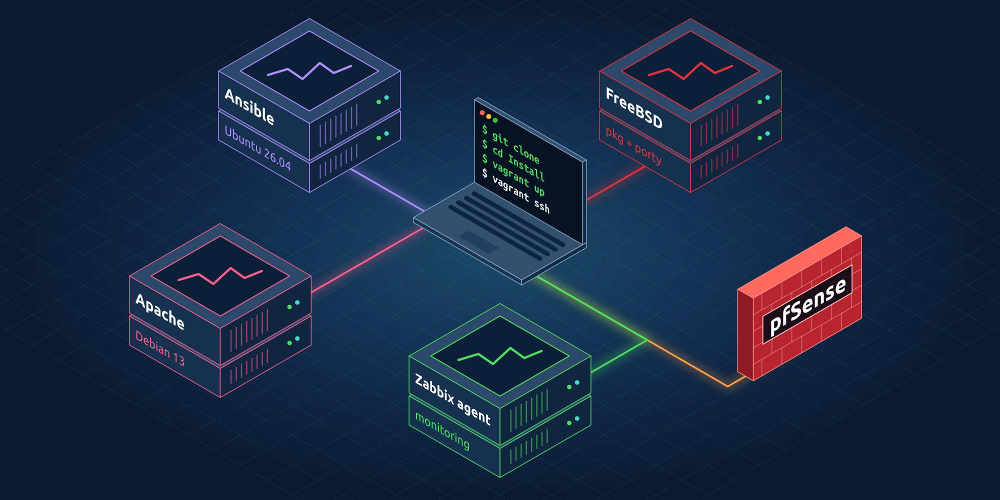

# Install
Repositories for teaching purposes at SPOS DK



Repository pro vyuku na SPOS DK

## Přehled ukázek

| Ukázka | Operační systém | Co ukazuje |
| --- | --- | --- |
| [Ansible](./Ansible/) | Ubuntu 26.04 | Automatizace: řídicí stanice `bastion`, Docker a Zabbix agent 2 |
| [Apache](./Apache/) | Debian 13 | Web server nainstalovaný bash skriptem |
| [FreeBSD](./FreeBSD/) | FreeBSD 14.3 | Základy systému, balíčky a porty, další služby |
| [pfSense](./pfSnese/) | pfSense CE 2.7.2 | Firewall a router vycházející z FreeBSD, monitoring pomocí SNMP |
| [ZabbixAgent](./ZabbixAgent/) | FreeBSD 14 | Zabbix agent 7.0 LTS s automatickou registrací |

## Jak začít

Budete potřebovat [Git](https://git-scm.com/), [Vagrant](https://developer.hashicorp.com/vagrant/install)
a [VirtualBox](https://www.virtualbox.org/wiki/Downloads) (verzi podporovanou Vagrantem).

```console
git clone https://github.com/sposdknl/2026-sposdk-osy/
cd 2026-sposdk-osy/Install/FreeBSD

vagrant up
vagrant ssh
```

Příkazy `vagrant` spouštějte v adresáři, který obsahuje `Vagrantfile`. Po skončení práce VM vypnete
příkazem `vagrant halt` a smažete příkazem `vagrant destroy`.

## Popis ukázek

### Ansible

Vytvoří VM `bastion` (192.168.1.5 v síti `intnet`), nainstaluje na ni [Ansible](https://docs.ansible.com/)
a naklonuje toto repository do `/opt/repo`. Playbook `configure_servers.yml` instaluje Docker
a Zabbix agenta 2 ve verzi 7.0 pomocí kolekce `community.zabbix`. Inventář počítá se Zabbix serverem na adrese 192.168.1.2.

### Apache

Adresář [srv01](./Apache/srv01/) vytvoří VM s Debianem 13, přidá do ní veřejný SSH klíč
a skriptem `install-apache.sh` nainstaluje Apache2. Web je na <http://127.0.0.1:8080/>.

### FreeBSD

Instalace FreeBSD, práce s `pkg` a porty a kompilace editoru joe. Navazují na ni samostatné ukázky:

| Ukázka | Obsah | Porty na hostiteli |
| --- | --- | --- |
| [Apache](./FreeBSD/Apache/) | Apache 2.4 z balíčku | SSH 2201, web 8001 |
| [MariaDB](./FreeBSD/MariaDB/) | MariaDB 12.3 LTS z balíčku | SSH 2201 |
| [ZabbixAgent](./FreeBSD/ZabbixAgent/) | Zabbix agent 8.0 LTS zkompilovaný z portu | SSH 2201 |
| [ZabbixServer](./FreeBSD/ZabbixServer/) | Zabbix server 8.0 LTS, MariaDB, Apache a PHP (VM potřebuje 4 GB RAM) | SSH 2211, web 8080 |

### pfSense

Firewall s rozhraními WAN, LAN a OPT1. Webové rozhraní je na <https://localhost:8888>. Ukázka popisuje
také monitoring přes SNMP v Zabbixu. LAN používá síť `intnet` (192.168.1.0/24), do které je připojený i `bastion` z ukázky Ansible.

### ZabbixAgent

Starší ukázka pro Zabbix 7.0 LTS: adresář [fbsdsrv01](./ZabbixAgent/fbsdsrv01/) instaluje agenta z balíčku,
vygeneruje unikátní hostname a nastaví automatickou registraci. Novější variantu pro Zabbix 8.0 LTS najdete
ve [FreeBSD/ZabbixAgent](./FreeBSD/ZabbixAgent/).

## Na co si dát pozor

- Ukázky `Apache/srv01` a `ZabbixAgent/fbsdsrv01` potřebují váš veřejný klíč `id_ed25519.pub` ve stejném adresáři jako `Vagrantfile`.
- Některé ukázky používají na hostiteli stejný port a nejdou spustit současně: 2201 (FreeBSD kromě Zabbix serveru
  a `ZabbixAgent/fbsdsrv01`) a 8080 (`Apache/srv01` a `FreeBSD/ZabbixServer`).
- Výchozí a ukázková hesla jsou jen pro výuku.

...
