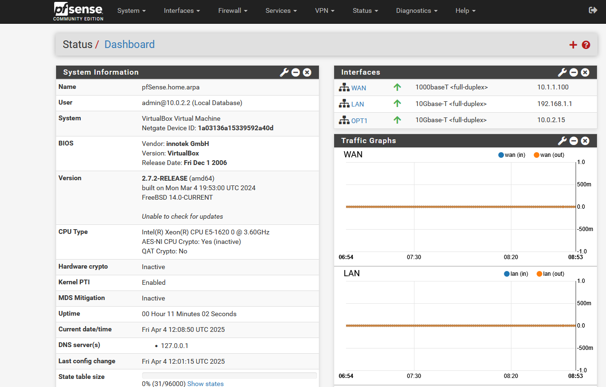
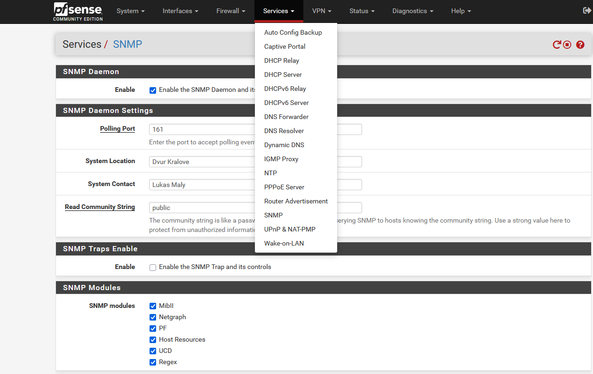

# Install pfSense
Repositories for teaching purposes at SPOS DK

Repository pro vyuku na SPOS DK

## Install OS

[pfSense](https://www.pfsense.org/download/)

- pfSense Vagrant Box (Image) - [cs-c4300/pfsense](https://portal.cloud.hashicorp.com/vagrant/discover/cs-c4300/pfsense)
  (pfSense CE 2.7.2, jiná verze boxu není k dispozici)
- Webové rozhraní: <https://localhost:8888>, uživatel `admin`, heslo `admin`

## Rozhraní

| Rozhraní | Síťová karta | IP adresa | Síť |
| --- | --- | --- | --- |
| WAN | `em0` | `10.1.1.100` (DHCP) | VirtualBox host-only |
| LAN | `vtnet1` | `192.168.1.1` | VirtualBox `intnet` |
| OPT1 | `vtnet0` | `10.0.2.15` | Vagrant NAT |

Stanice v síti LAN je vidět v ARP tabulce:

## Monitoring pomocí SNMP

Služba se zapíná v *Services / SNMP*. Community `public` je vhodná jen pro výuku.

...
