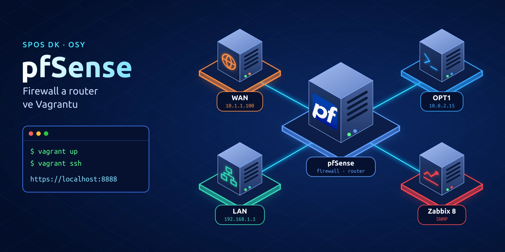
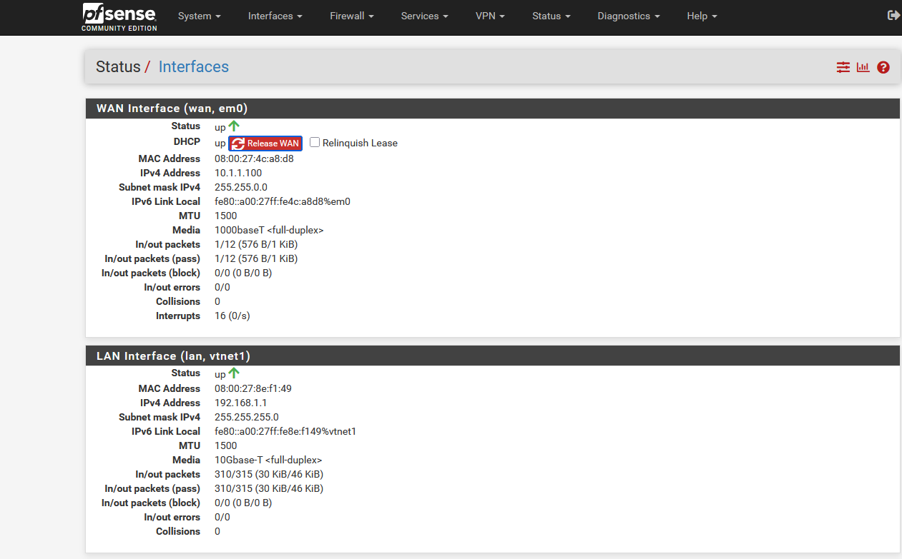
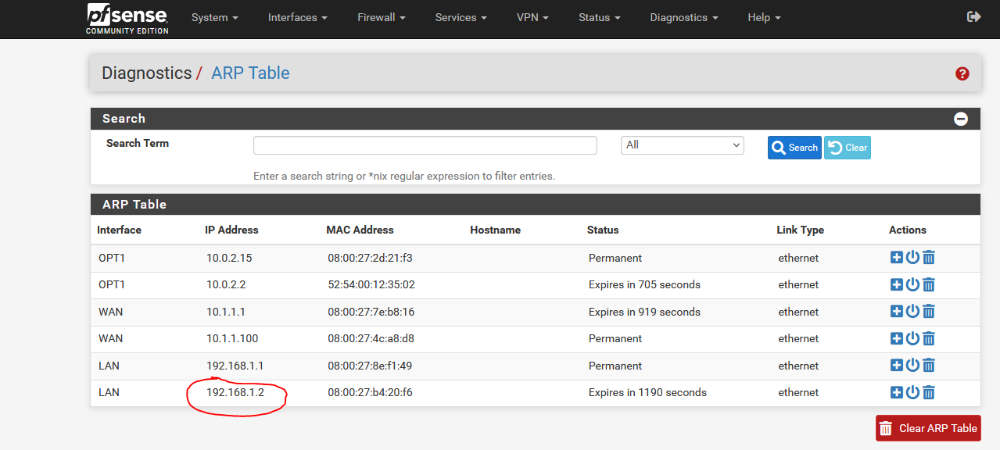

# Install pfSense
Repositories for teaching purposes at SPOS DK



Repository pro vyuku na SPOS DK

## Install OS

[pfSense](https://www.pfsense.org/download/)

- pfSense Vagrant Box (Image) - [cs-c4300/pfsense](https://portal.cloud.hashicorp.com/vagrant/discover/cs-c4300/pfsense)
  (pfSense CE 2.7.2, jediná verze tohoto boxu; aktuální pfSense CE je 2.9.x)
- Webové rozhraní: <https://localhost:8888> (vlastní certifikát, prohlížeč zobrazí varování),
  uživatel `admin`, heslo `admin`

```console
vagrant up
vagrant ssh
```

Na Linuxu musí mít VirtualBox povolený rozsah host-only sítě 10.0.0.0/8 v souboru `/etc/vbox/networks.conf`:

```console
* 10.0.0.0/8 192.168.0.0/16
```

Pokud už ve VirtualBoxu existuje starší VM se jménem `pfsense-box`, nejprve ji přejmenujte nebo odstraňte.


## Rozhraní

| Rozhraní | Síťová karta | IP adresa | Síť |
| --- | --- | --- | --- |
| WAN | `em0` | `10.1.1.100`–`10.1.1.200` (DHCP) | VirtualBox host-only `10.1.0.0/16` |
| LAN | `vtnet1` | `192.168.1.1` | VirtualBox `intnet` |
| OPT1 | `vtnet0` | `10.0.2.15` | Vagrant NAT |



Stanice v síti LAN je vidět v ARP tabulce:



WAN je pouze host-only síť bez přístupu na internet. Rozhraní OPT1 (NAT) používá Vagrant.
Další VM zařadíte do sítě LAN nastavením `virtualbox__intnet: "intnet"`.

## Monitoring pomocí SNMP

Služba se zapíná v *Services / SNMP*. Community `public` je vhodná jen pro výuku.
V Zabbixu 8 použijte šablonu `PFSense by SNMP`. Zabbix server musí být v síti LAN,
pro přístup z WAN je potřeba pravidlo firewallu pro UDP port 161.


...
